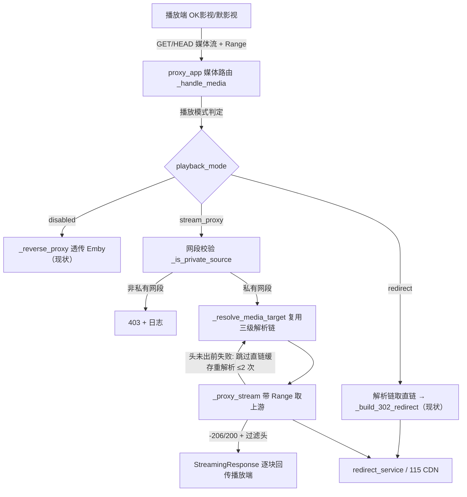

# Stream Proxy Mode（局域网流代理模式）

Feature Name: stream-proxy-mode
Updated: 2026-11-08

## Description

将管理面板现有"302 直链"布尔开关升级为三态互斥单选"播放模式"（`disabled` / `redirect` / `stream_proxy`）。新增的 `stream_proxy` 态下，Emby 前置代理对媒体路由不再下发 302 直链，改为由工具自身向 115 CDN 取流并转发给播放端；播放端全程只连接工具地址，暂停恢复与 seek 触发的重连全部落在稳定入口，直链时效问题对播放端透明化。仅服务私有网段来源（强制内置），其余链路与现有行为逐项一致。

对应需求：`.monkeycode/specs/stream-proxy-mode/requirements.md` R1-R7。

## Architecture



媒体路由之外的路径（PlaybackInfo 注入、WS 代理、HTML 注入、外部播放器解码、通用反向代理）不改动：`stream_proxy` 在 PlaybackInfo 处理器中表现为"跳过 Path 直链替换"，与现状 `redirect_mode=false` 分支行为一致。

## Components and Interfaces

### 1. `config_manager.py` — 播放模式枚举与兼容

- 新增 `class PlaybackMode(str, Enum)`：`DISABLED = "disabled"`、`REDIRECT = "redirect"`、`STREAM_PROXY = "stream_proxy"`。
- 配置模型新增字段 `playback_mode: PlaybackMode = PlaybackMode.DISABLED`，**移除** `redirect_mode` 布尔字段。
- 兼容读取：配置加载时对旧 JSON（仅含 `"redirect_mode": true|false`）做一次性迁移映射（`true→redirect`、`false→disabled`），写入时只写 `playback_mode`，与既有配置迁移模式（如数据库启动自迁移风格）对齐。
- 校验：非法字符串值加载失败时回落 `DISABLED` 并记日志警告（与现有配置项容错风格一致）。

### 2. `admin_api.py` — 配置接口

- `ConfigUpdate` 增加 `playback_mode: Optional[str] = None`，删除 `redirect_mode: Optional[bool]`；收到 `redirect_mode` 旧字段请求体时映射为 `playback_mode`（API 兼容期，返回体统一新字段）。
- 校验取值 ∈ 枚举，非法值 422。

### 3. `combined/static/admin.html` — 面板控件

- "302 直链播放"复选框替换为单选组：关闭 / 302 直链 / 流代理（局域网），附一行说明"流代理由本机转发媒体流，仅响应内网设备，暂停续播不掉链"。
- 保存/回显走既有配置读写通道。

### 4. `proxy_app.py` — 媒体路由与流代理核心

重构点均在该文件工厂闭包内，沿用现有 `app.state` 缓存与锁：

- **拆分解析与响应**：从 `_try_media_response`（现有 619-822 行）抽出 `async def _resolve_media_target(item_id, api_key, request, *, skip_final_url_cache: bool) -> Optional[str]`，返回解析出的最终直链（或 None）。内部保持：用户缓存 → `playback_url_cache`（`skip_final_url_cache=True` 时跳过此级）→ PlaybackInfo → STRM 源缓存 → `_resolve_redirect` HEAD，以及 `key_lock` 防击穿。调用方按模式决定 302 或取流。
- **`_handle_media` 模式分发**：`name in NON_MEDIA_NAMES` 仍先走 `_reverse_proxy`；随后取 `playback_mode`：`DISABLED` → `_reverse_proxy`；`REDIRECT` → 现 302 行为；`STREAM_PROXY` → 网关校验 → `_resolve_media_target` → `_proxy_stream`。
- **`_proxy_stream(request, direct_url) -> Response`** 新函数：
  1. `http_client_no_follow` GET（非跟随重定向；直链即最终地址，若上游又回 3xx 按失败链处理）转发 `_build_forward_headers(request)`（含播放端 UA——直链按 UA 绑定签发，UA 不一致 CDN 拒流）。
  2. 响应头白名单转发：`status_code`、`Content-Type`、`Content-Length`、`Content-Range`、`Accept-Ranges`；显式丢弃 `Content-Disposition`、`ETag`、`Last-Modified`、`Expires`、`Cache-Control`、`Set-Cookie`、传输编码相关头。
  3. 流式回传复用现有 `stream()` 模式（`aiter_bytes(chunk_size=65536)`，`finally: resp.aclose()`），客户端断开由 Starlette 取消任务触发 finally 关闭上游。
  4. **重试状态机（仅响应头产出前）**：上游连接异常、HTTP 403/404、或"请求带 Range 而上游返回 200（Range 被忽略）"→ `sleep(退避 0.5s/1.5s)` 后以 `skip_final_url_cache=True` 重走 `_resolve_media_target` 再试；累计重解析 `≤ _STREAM_RETRY_MAX=2` 次、自请求进入起 `≤ _STREAM_RETRY_BUDGET_S=10` 秒；超限 → `JSONResponse 502` + `logger.error`（item_id、尝试次数、末次错误类型）。
  5. 已产出响应头后的中断处理见"Error Handling：半身后断"。
- **PlaybackInfo 处理器调整**：1110 行 `if redirect_mode:` 改为 `if playback_mode is PlaybackMode.REDIRECT:`（`stream_proxy` 下 MediaSources.Path 不预替换直链）。`_apply_force_direct_play_to_media_sources` 与 STRM 源缓存回填三态下均保持执行。
- **网段校验 `_is_private_source(request) -> bool`**：复用既有 `_real_client_ip`（含 XFF/X-Real-IP）+ `ipaddress.ip_address(...).is_private`（RFC1918、环回、ULA 一并覆盖）。流代理模式下非私有来源 → `403` + 来源 IP 日志。

### 5. `redirect_service.py`

不改动。`_resolve_media_target` 经既有 redirect URL 入口取链，自动继承：UA 绑定、`expires_time` 收敛 TTL 缓存、same_playback 副本、防击穿、写频控退避。

## Data Models

无新增持久化结构；配置 JSON 字段变化：

```jsonc
{
  // 移除 "redirect_mode": true
  "playback_mode": "stream_proxy"  // disabled | redirect | stream_proxy
}
```

模块常量：`_STREAM_RETRY_MAX = 2`、`_STREAM_RETRY_BUDGET_S = 10.0`、`_STREAM_RETRY_BACKOFF = (0.5, 1.5)`、`_UPSTREAM_STRIP_HEADERS`（转发丢弃头集合）、`_UPSTREAM_FORWARD_HEADERS`（转发保留头白名单）。

## Correctness Properties

- P1：`playback_mode ∈ {disabled, redirect}` 时，媒体路由的全部响应字节与 header 与实施前实现逐项一致（回归基线）。
- P2：流代理响应中，播放端收到的状态码、`Content-Range`、`Content-Length` 与上游 115 CDN 对同一 Range 请求的响应一致；响应头中 `ETag`、`Last-Modified`、`Content-Disposition` 出现次数为 0。
- P3：流代理响应到达播放端的 header 与 body 中，115 CDN 域名出现次数为 0（Location 不复用于流模式）。
- P4：任一请求线程内，已建立的 httpx stream 响应对象在请求结束时处于 closed 状态（含失败/断开路径）。
- P5：同一 cache_key 并发 N 路请求，单时间窗内对 redirect_url 端点的 HEAD 解析次数为 1（击穿防护保持）。
- P6：私有网段限制在配置与 API 两条路径均无关闭字段。

## Error Handling

| 场景 | 行为 |
|---|---|
| 非私有网段来源 | 403 JSON `{error: "stream proxy limited to private networks"}` + 来源 IP 日志 |
| 解析链完整失败（http_path 取不到） | `_handle_media` 按既有语义回退 `_reverse_proxy`（与 `disabled` 同分支） |
| 直链解析失败（HEAD 超时/非 2xx） | 消耗重试预算重解析；预算尽 → 502 + 日志 |
| 上游 403/404（直链过期主场景） | 跳过 `playback_url_cache` 重解析 + 重试 ≤2 次，预算 10s；成功则 206/200 正常回传 |
| Range 被上游忽略（带 Range 得 200） | 视为异常，按上行重试；重试仍 200 则原样转发 200（播放器按整文件自处理） |
| 退避/重试总耗时越限 | 放弃重试，502 + 日志（item_id、尝试次数、末次错误） |
| **半身后断**（响应头已提交、body 中断） | 无法在同一响应内自愈（状态码已不可改）；关闭上游并记 `logger.error`，预期播放端重新发起 Range 请求 → 新请求走完整重试状态机恢复。此为需求 R3"播放端无感"的实现边界，需求侧"暂停恢复"场景命中"头未出"路径不受影响 |
| 播放端断开 | Starlette 取消 → `stream()` finally `resp.aclose()`，无僵尸连接 |

## Test Strategy

- 新增 `combined/test_stream_proxy_mode.py`（必须 standalone 单文件可跑，复用 `conftest.py` 的 `stub_modules`/`stub_missing`，不触真实网络/SDK）：
  1. `disabled` 态媒体路由行为回归（302/透传快照）。
  2. `redirect` 态与现状一致（回归基线，复用 `test_redirect_method.py` 的本地 mock server 模式）。
  3. `stream_proxy` + 私有来源：206/Range 透传、白名单头转发、`Content-Disposition`/`ETag` 被剥离（2-3 例）。
  4. 上游首请求 403 → 跳缓存重解析 → 第二次成功回 206（自愈主用例，断言解析调用次数=2）。
  5. 上游 403×3 → 502（含退避 sleep 打桩，`monkeypatch asyncio.sleep`）。
  6. 非私有来源 → 403（含 XFF 改写来源用例）。
  7. HEAD 请求头回传、body 为空。
  8. 客户端断开 → 上游响应 closed（用 `TestClient`/`httpx.ASGITransport` 断流断言）。
  9. 并发 5 路同 key → 解析仅 1 次（对齐 `test_redirect_stampede.py` 写法）。
  10. 配置迁移：旧 JSON `redirect_mode=true/false` 加载映射、API 旧字段读写兼容（对齐 `test_admin_config.py`）。
- 预计新增约 12 例，合入后以 `python -m pytest --collect-only -q` 实测数同步四处文档（README.md:67、TODO.md:37、.monkeycode/docs/INDEX.md:78、.monkeycode/docs/DEVELOPER_GUIDE.md:111，基线 229）。
- 3.14 行为验证按既有门禁：本地 3.11 跑 ruff+pytest，最终以 CI 为准；涉及真实 115 行为的部分只能实机验收（电视端暂停 5 分钟续播冒烟）。

## References

[^1]: (Filename#L619-L822) - 现有 302 媒体路由：[proxy_app.py](../../../combined/proxy_app.py)
[^2]: (Filename#L14-L16) - 三态枚举配置定义：[config_manager.py](../../../combined/config_manager.py)
[^3]: (Filename#L96) - 现有配置接口字段：[admin_api.py](../../../combined/admin_api.py)
[^4]: (Filename#L225-L242) - TTL 与 expires_time 收敛：[redirect_service.py](../../../combined/redirect_service.py)
[^5]: (Filename#L150-L157) - 真实客户端 IP 口径：[redirect_service.py](../../../combined/redirect_service.py)
[^6]: spec - [requirements.md](./requirements.md)
