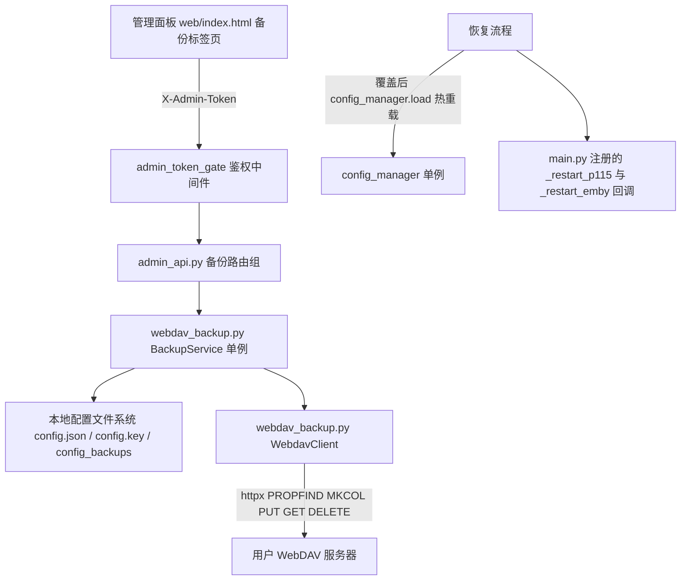

# WebDAV 远端备份

Feature Name: webdav-remote-backup
Updated: 2026-10-18

## Description

在现有本地配置滚动快照（`config_backups/`，10 份上限）之上增加 WebDAV 远端备份闭环：面板手动触发后，把 `config.json`、`config.key`、签到状态文件 `checkin_state.json` 与 `config_backups/` 下全部本地快照打包为带 SHA-256 清单的 zip 档案，自检通过后上传到用户自备的 WebDAV 目录，按保留份数滚动清理；支持远端列表查看、下载与恢复。零新增第三方依赖（httpx + 标准库 zipfile/hashlib/xml.etree）。仅手动触发，档案内容与磁盘形态一致，信任边界是 WebDAV 访问控制（见 requirements.md 决策记录）。

## Architecture



分层原则：`WebdavClient` 只做协议收发（可被 httpx.MockTransport 整体替换）；`BackupService` 承载打包、自检、上传核对、清理、下载、恢复与互斥锁；`admin_api.py` 只做参数校验与错误转译，不触协议。新增一个模块、一组常量、一个配置节，不改动现有同步/跳转/签到核心路径。

## Components and Interfaces

### combined/webdav_backup.py（新增核心模块）

常量：`BACKUP_NAME_PREFIX = "115strmtool-backup-"`、`BACKUP_NAME_SUFFIX = ".zip"`、`BACKUP_TIMEOUT = httpx.Timeout(30.0, connect=10.0)`、`HTTP_TIMEOUT` 之外无魔法数。

`class WebdavClient`：

- `__init__(base_url: str, username: str, password: str)`：构建 httpx.Client（BasicAuth、follow_redirects=True、BACKUP_TIMEOUT）；`_url(rel: str)` 做 urljoin + `quote()` 转义
- `test_connection() -> Tuple[bool, str]`：MKCOL 逐级建目录 → PROPFIND depth 1 验证读 → PUT/DELETE 匿名探针文件 `.115strmtool-write-probe` 验证写；返回 (成功, 失败根因分类文案)
- `list_archives() -> List[Dict[str, Any]]`：PROPFIND depth 1，`xml.etree` 解析 multistatus（namespace `DAV:`），过滤 `BACKUP_NAME_PREFIX` + 后缀 `.zip` 的条目，返回 `{name, size, last_modified}` 按档案名升序
- `put(rel: str, data: bytes)`、`get(rel: str) -> bytes`、`delete(rel: str)`：非 2xx 抛 `ServiceError`

`class BackupService`：

- `run_backup() -> Dict`：非阻塞获取 `_task_lock`，失败即返回"备份进行中"；调用 `_create_archive()` → `_verify_archive(path)`（失败即返回，零网络写）→ 远端 list → 定档案名 → PUT → GET 核对大小 → `_prune_remote()`；try/finally 释放锁清理暂存文件
- `restore_backup(name: str) -> Dict`：非阻塞获取同一把锁；拼 URL 前先用 `BACKUP_NAME_RE` 对档案名做全串匹配，拒绝注入式路径输入；下载 → `_verify_archive` 全量校验 → 写 guard 快照（`config_backups/restore-guard-<ts>-config.json` 与 `-config.key`，`restore-guard` 前缀天然避开 `config-*.json` 轮换 glob）→ 依次 `os.replace` 覆盖 `config.json`、`config.key`（档案含 `checkin_state.json` 时一并覆盖）→ `config_manager.load()`；覆盖中途异常时把 guard 快照原样写回（整体或原状的最终兜底）
- `_create_archive() -> Path`：暂存于 `tempfile.mkdtemp(prefix="115strm-backup-")`；成员映射固定白名单：根级 `config.json`、`config.key`（缺 config.key 则拒绝打包并提示原因），根级 `checkin_state.json`（可缺），`backups/config-*.json` 全部快照；manifest 最后写入，成员条目含 `path/size/sha256` 与 `app_version`、`created_at`
- `_verify_archive(path) -> Tuple[bool, str]`：`ZipFile.testzip()` CRC 校验 → manifest 解析 → 每条成员重读比对 size 与 SHA-256 → 必备成员存在性（config.json、config.key、manifest.json）→ **路径穿越拒绝**：条目名含 `..`、绝对路径、盘符即失败
- `_prune_remote(archives: List)`：超出 `keep_count` 的部分从最旧开始 DELETE；清理失败仅记 warning

模块级导出 `backup_service: BackupService` 与 `BACKUP_NAME_RE`（`^115strmtool-backup-\d{8}-\d{6}(-\d{1,2})?\.zip$`）。

### combined/config_manager.py（修改）

- 新增 `WebdavBackupConfig(BaseModel)` 并挂到 `RootConfig.webdav`（见数据模型）
- 通用化秘密落盘：把 `_write`/`load` 中对 `p115.cookie` 的加解密泛化为字段表 `[("p115", "cookie"), ("webdav", "password")]`，加解密实现不动；无 `#ENC#` 前缀的存量值按明文读出，下次写盘自动转加密（向后兼容）
- `mask_config` 增加 `webdav.password` 掩码分支（掩码常量沿用 `COOKIE_MASK`）

### combined/admin_api.py（修改，全部挂在既有 router 下自动受 admin_token_gate 保护）

| Method | Path | 行为 |
|--------|------|------|
| GET | `/backup/webdav/config` | 返回 webdav 配置（password 掩码） |
| POST | `/backup/webdav/config` | 保存配置；password 为掩码时对已存值透传保留（与 cookie 约定一致）；`enabled=false` 即全局禁用入口 |
| POST | `/backup/webdav/test` | 调 `test_connection`，返回 `{ok, message}` |
| POST | `/backup/run` | 调 `run_backup`，返回 `{ok, name, size}` 或错误；`enabled=false` 或未配置 URL 返回明确提示 |
| GET | `/backup/remote` | 调 `list_archives` 返回列表 |
| GET | `/backup/remote/download?name=` | `BACKUP_NAME_RE.match` 全名匹配后 GET 透传 zip 响应（Content-Disposition 附件） |
| POST | `/backup/restore` | body `{"name": ...}`；`BACKUP_NAME_RE` 匹配后调 `restore_backup` |

所有处理器为同步 `def`；错误经既有 `ServiceError` → 全局异常处理转 JSON `{error}`（与现有端点一致）。

### combined/main.py（修改，仅恢复接线）

恢复成功后的热重载接线：`POST /backup/restore` 路由处理器在 `restore_backup` 返回成功后，直接调用同模块（`admin_api`）内已注册的全局回调 `_restart_p115_callback / _restart_emby_callback`（存在则调用，未注册跳过），使新配置立即生效。回调由 `main.py` line 338-339 既有 `set_*_restart_callback` 注册，main.py 本特性零改动；服务层 `webdav_backup.py` 不 import admin_api，避免循环依赖。

### combined/web/index.html（修改）

仿签到页新增 `data-tab="backup"` 标签页：

1. 设置区：启用开关、服务器 URL、用户名、密码(password 输入)、远端子目录、保留份数；"保存配置""测试连接"按钮（`apiFetch` 调用）
2. 操作区："立即备份"按钮 + 结果展示卡（时刻/档案名/大小或失败原因）
3. 远端列表：刷新按钮 + 表格（档案名、大小格式化、修改时间），每行"下载"（浏览器导航下载带不上 `X-Admin-Token` 头，采用 fetch→blob→临时 `<a download>` 触发）与"恢复"（`confirm()` 二次确认，遵循浏览器弹窗直接确认既有约定）

## Data Models

### 配置节（config.json webdav 段，按 AGENTS.md 以 Field description 实现）

```python
class WebdavBackupConfig(BaseModel):
    """
    WebDAV 远端备份配置
    """

    enabled: bool = Field(default=False, description="远端备份总开关")
    url: str = Field(default="", description="WebDAV 根地址，http(s) 开头")
    username: str = Field(default="", description="WebDAV 账号")
    password: str = Field(default="", description="WebDAV 密码，落盘加密、展示掩码")
    remote_subdir: str = Field(default="115strmtool-backups", description="远端备份子目录，逐级创建")
    keep_count: int = Field(default=10, ge=1, description="远端保留档案份数")
```

默认全空即"未启用"，`enabled=False` 下 `/backup/run` 与 `/backup/restore` 拒绝。

### 备份档案结构

```text
115strmtool-backup-<YYYYmmdd-HHMMSS>[-N].zip
├── manifest.json          # {app_version, created_at, members: [{path,size,sha256}]}
├── config.json            # 磁盘原样（cookie 密文）
├── config.key             # 必备成员
├── checkin_state.json     # 可选（未启用签到时缺省）
└── backups/config-*.json  # 本地滚动快照全量
```

档案名同秒撞名追加 `-2`～`-99`；名字典序即时间序，列表排序与清理判定都以名为准，不依赖服务器返回的 `getlastmodified`。

### 恢复写盘范围（备份范围 > 恢复写盘范围的刻意决策）

恢复仅覆盖 `config.json`、`config.key` 与（档案含该项时）`checkin_state.json`；档案内的 `backups/` 快照解到暂存后丢弃不写回本地快照目录（本地历史目录与档案历史混合会污染轮换语义；需要更早历史时直接从对应远端档案恢复）。

## Correctness Properties

1. **自检门禁**：上传请求发出前，目标档案已完成 CRC + manifest 全成员 size/SHA-256 校验；校验失败的档案任何路径下都不会发出网络写请求
2. **传输一致**：上传后必然执行远端 GET 大小核对，不一致按失败处理且保持远端零删除
3. **清理单调**：任何时刻远端匹配档案数 ≤ `keep_count`（清理失败为软失败，下次任务补偿重试）
4. **恢复原子性**：恢复以 guard 快照兜底，要么完全生效要么本地配置与密钥回到恢复前状态；guard 文件命名避开 `config-*.json` glob，不会被快照轮换删除
5. **互斥性**：同一时刻至多一个备份或恢复任务（共用 `_task_lock`），第二个请求立即得到"进行中"答复
6. **路径安全**：档案名进入 URL 前过 `BACKUP_NAME_RE` 全名匹配；解包目标恒为程序固定目标，忽略清单外路径；manifest 拒绝含 `..`/绝对路径/盘符条目

## Error Handling

| 场景 | 处理 | 用户可见表现 |
|------|------|-------------|
| 连接测试网络错误（ConnectError/Timeout） | 归类为网络不可达 | "服务器不可达：…" |
| 401 | 归类为认证失败 | "账号或密码错误" |
| 403/405、MKCOL 非 201/204/405 | 归类为无写入权限或目录创建失败 | "目标目录不可写：…" |
| 自检失败（CRC/摘要/缺成员/穿越条目） | 终止，零网络写 | "档案自检失败：<具体项>" |
| 上传或核对失败 | 终止本轮，零删除 | 错误文案含档案名或失败环节 |
| 远端清理单文件 DELETE 失败 | warning 日志，本轮仍成功，下次补偿 | 列表仍可见旧档案 |
| 恢复清单不符/校验失败 | 中止并保持本地现状 | "校验失败，已保持当前配置" |
| 恢复覆盖中途异常 | 用 guard 还原两个必备文件 | "恢复失败，已还原到恢复前配置" |
| 并发触发 | 非阻塞锁拒绝 | "已有备份/恢复任务进行中" |
| WebDAV 返回非 multistatus XML | 解析失败按列表失败 | "读取远端列表失败" |

HTTPS 保持默认证书校验，不提供跳过校验开关；自签名服务器不在本期用户故事内。

## Test Strategy

- 单元测试沿用 `combined/` pytest 惯例，conftest stub_modules 已隔离重依赖；WebDAV 用 `httpx.MockTransport` 构造 207/201/401/403/500 与损坏响应，tmp_path + monkeypatch 指认 CONFIG_FILE / CONFIG_BACKUP_DIR（复用 `test_config_manager._backup_config` 模式）
- 预估新增 22 用例左右，覆盖：config 保存加载与 password 落盘加密与掩码、test_connection 三类根因、打包 manifest 正确性、自检各失败分支（篡改字节 → CRC、改 size、删除成员、注入 `../` 条目）、上传成功与核对失败、清理保留 N 份与清理软失败、同秒撞名加序号、恢复全流程（改配置前备份 → 破坏本地 → 恢复 → 断言热重载）、缺 config.key 拒绝打包、恢复覆盖异常 guard 还原、名称白名单拒绝路径输入、禁用状态下端点拒绝、并发锁拒绝
- 本地门禁不变：`ruff check .` + `cd combined && python -m pytest -q`；CI 门禁同
- 沙箱装不上真实 p115client 的既有约定不受影响（备份模块零依赖 SDK）

## Design Decisions

1. **同步端点而非任务队列**：单用户桌面工具，档案体积几十 KB 量级，FastAPI 线程池同步执行简单可靠；排队语义降级为"进行中即拒绝"，与 TODO 对单机自用复杂度的裁剪倾向一致
2. **恢复不覆盖本地快照目录**：保持本地快照是本地操作时间线的纯净序列，历史追溯交给远端档案本身
3. **名字典序当时间序**：规避不同 WebDAV 服务器 `getlastmodified` 格式与偏移差异；格式 `YYYYmmdd-HHMMSS` 定长字典序天然单调，同秒以 `-N` 序号后缀区分
4. **password 落盘复用密码派生**：config.key 派生机制对"任意敏感字符串"泛化，不引入新加密路径；档案里密码密文与 key 同包的暴露面维持决策现状
5. **不提供周期调度**：2026-10-18 用户决策；模块已具备单例与锁基座，未来加调度器只需按签到模式起一个轮询线程调 `run_backup`
6. **写探针文件 test_connection**：比"能 PROPFIND"更接近备份实际需要（需可建目录可 PUT），探针文件名带应用前缀且用后即删

## References

[^1]: (requirements.md) - 当前规格的验收标准与决策记录 .monkeycode/specs/webdav-remote-backup/requirements.md
[^2]: (config_manager.py#L246) - 本地滚动快照 `_maybe_backup`（rotation glob 与 1 小时隔闸语义，guard 文件命名需避开）combined/config_manager.py
[^3]: (main.py#L253) - `admin_token_gate` 中间件（新路由自动受保护）combined/main.py
[^4]: (main.py#L338) - `_restart_emby/_restart_p115` 回调注册点，恢复后复用 combined/main.py
[^5]: (test_admin_config.py) - 掩码保留与重启回调的既有测试模式 combined/test_admin_config.py
